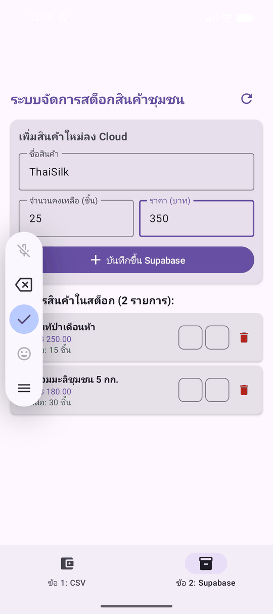
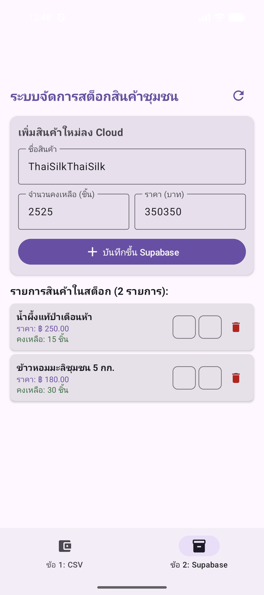

# 📚 คู่มือฉบับสมบูรณ์และการเตรียมตัวนำเสนอผลงาน (Master Submission Guide)
### ข้อสอบปฏิบัติการพัฒนา Android ด้วย Kotlin

---

### 👤 ข้อมูลนักศึกษา
- **ชื่อ-นามสกุล:** นายกฤษฎา ศรีคิลิน
- **รหัสนักศึกษา:** 67102122111
- **รายวิชา:** การปฏิบัติการพัฒนา Android ด้วย Kotlin (Android Mobile Development)
- **วันเวลาที่นำเสนอ:** วันที่ 11 ตุลาคม 2569 เวลา 9:00 น. เป็นต้นไป (ห้องพักครู ชั้น 3 อาคาร 7)
- **GitHub Repository:** [https://github.com/Frokezero/F111.git](https://github.com/Frokezero/F111.git)

---

## 🎥 วิดีโอสาธิตการทำงาน (Animated GIFs)

| ข้อที่ 1: บันทึกรายรับ-รายจ่าย (.CSV) | ข้อที่ 2: สต็อกสินค้าชุมชน (Supabase) |
|:---:|:---:|
|  |  |

---

## 📑 สรุปการให้คะแนนตามเกณฑ์ (Scoring Rubrics Checklist)

### 🟢 ข้อที่ 1: ระบบบันทึกรายรับ-รายจ่ายส่วนบุคคลด้วยไฟล์ CSV (15 คะแนนเต็ม)
| เกณฑ์ | รายละเอียดการประเมิน | จุดตรวจในซอร์สโค้ด | คะแนน |
|---|---|---|:---:|
| **1. สถาปัตยกรรม MVVM & Repository** | แยก Model, Repository, ViewModel, View ชัดเจน / ไม่มี Business Logic หรือ File I/O ใน UI / หมุนจอแล้ว State ไม่หาย | [TransactionRepository.kt](file:///C:/Users/froke/.gemini/antigravity-ide/scratch/android_exam_solutions/app/src/main/java/com/example/combinedsolutions/feature/expense/data/repository/TransactionRepository.kt) & [TransactionViewModel.kt](file:///C:/Users/froke/.gemini/antigravity-ide/scratch/android_exam_solutions/app/src/main/java/com/example/combinedsolutions/feature/expense/ui/viewmodel/TransactionViewModel.kt) | **4** |
| **2. ระบบไฟล์ CSV (บันทึก/อ่าน/ลบ/ส่งออก)** | Append ข้อมูลลง `.csv` ถูกต้อง / Parse บรรทัดต่อบรรทัด / ลบไฟล์จริง / **ส่งออกไฟล์ CSV จริงไปที่โฟลเดอร์ Downloads** | [TransactionRepositoryImpl.kt](file:///C:/Users/froke/.gemini/antigravity-ide/scratch/android_exam_solutions/app/src/main/java/com/example/combinedsolutions/feature/expense/data/repository/TransactionRepositoryImpl.kt) (`exportCsvToDownloads()`) | **4** |
| **3. การคำนวณและแสดงผล (Business Logic)** | คำนวณยอดสุทธิ (รายรับ - รายจ่าย) ถูกต้อง / LazyColumn แสดงชื่อ, วันที่, เวลา, จำนวนเงินแยกสี | [TransactionContent.kt](file:///C:/Users/froke/.gemini/antigravity-ide/scratch/android_exam_solutions/app/src/main/java/com/example/combinedsolutions/feature/expense/ui/screen/TransactionContent.kt) | **3** |
| **4. UI ด้วย Jetpack Compose** | Layout สวยงามตามโจทย์ / RadioButton, OutlinedTextField, Card, Button / **รองรับ Adaptive 2-Column Split ในแนวนอน** | [TransactionContent.kt](file:///C:/Users/froke/.gemini/antigravity-ide/scratch/android_exam_solutions/app/src/main/java/com/example/combinedsolutions/feature/expense/ui/screen/TransactionContent.kt) | **2** |
| **5. Thread Safety (Coroutines)** | `Dispatchers.IO` สำหรับ File I/O / `viewModelScope.launch` เบื้องหลัง ไม่เกิด UI Freeze | มีการครอบ `withContext(Dispatchers.IO)` ทุกฟังก์ชัน | **2** |
| **รวม** | | | **15** |

---

### 🔵 ข้อที่ 2: ระบบจัดการสต็อกสินค้าชุมชนบน Cloud Database (Supabase) (15 คะแนนเต็ม)
| เกณฑ์ | รายละเอียดการประเมิน | จุดตรวจในซอร์สโค้ด | คะแนน |
|---|---|---|:---:|
| **1. ความครบถ้วนของ CRUD** | Create (Insert แถวใหม่) / Read (ดึงรายการเรียง id DESC) / Update (ปรับสต็อก $\pm 1$ ทันที) / Delete (ลบตาม ID) | [ProductRepositoryImpl.kt](file:///C:/Users/froke/.gemini/antigravity-ide/scratch/android_exam_solutions/app/src/main/java/com/example/combinedsolutions/feature/stock/data/repository/ProductRepositoryImpl.kt) | **5** |
| **2. สถาปัตยกรรม MVVM & Repository** | แยกเลเยอร์ชัดเจน / ไม่เรียก SDK ตรงใน UI / หมุนจอแล้ว State ไม่หาย | [ProductViewModel.kt](file:///C:/Users/froke/.gemini/antigravity-ide/scratch/android_exam_solutions/app/src/main/java/com/example/combinedsolutions/feature/stock/ui/viewmodel/ProductViewModel.kt) | **4** |
| **3. การสร้าง UI ด้วย Jetpack Compose** | ฟอร์ม OutlinedTextField, Button, LazyColumn, Card สวยงาม / **รองรับ Adaptive 2-Column Split ในแนวนอน** | [ProductStockContent.kt](file:///C:/Users/froke/.gemini/antigravity-ide/scratch/android_exam_solutions/app/src/main/java/com/example/combinedsolutions/feature/stock/ui/screen/ProductStockContent.kt) | **3** |
| **4. Asynchronous & Coroutines** | `viewModelScope.launch` และ Network I/O บน `Dispatchers.IO` ลื่นไหลไม่กระตุก | มีการสลับ Thread สำหรับ Network Request ทั้งหมด | **3** |
| **รวม** | | | **15** |

---

## 🏛️ สถาปัตยกรรมและการทำงานของซอร์สโค้ด (Architecture Details)

### 1. การแบ่ง Layer ตามหลัก Clean Architecture & MVVM
- **Model Layer (`data/model`):**
  - [Transaction.kt](file:///C:/Users/froke/.gemini/antigravity-ide/scratch/android_exam_solutions/app/src/main/java/com/example/combinedsolutions/feature/expense/data/model/Transaction.kt): เก็บโครงสร้างข้อมูลรายการ แปลงเป็น CSV Row String (`toCsvRow()`) และ Parse กลับเป็น Object (`fromCsvRow()`)
  - [Product.kt](file:///C:/Users/froke/.gemini/antigravity-ide/scratch/android_exam_solutions/app/src/main/java/com/example/combinedsolutions/feature/stock/data/model/Product.kt): ติดตั้ง `@Serializable` และ `@SerialName` สำหรับ Mapping คอลัมน์ PostgreSQL บน Supabase
- **Repository Layer (`data/repository`):**
  - [TransactionRepositoryImpl.kt](file:///C:/Users/froke/.gemini/antigravity-ide/scratch/android_exam_solutions/app/src/main/java/com/example/combinedsolutions/feature/expense/data/repository/TransactionRepositoryImpl.kt): จัดการไฟล์ I/O ทั้งการเขียนแบบ Append, อ่าน Parse ทีละบรรทัด, ลบไฟล์ และก๊อปปี้ไฟล์ไปยังโฟลเดอร์สาธารณะ `Downloads` บน `Dispatchers.IO`
  - [ProductRepositoryImpl.kt](file:///C:/Users/froke/.gemini/antigravity-ide/scratch/android_exam_solutions/app/src/main/java/com/example/combinedsolutions/feature/stock/data/repository/ProductRepositoryImpl.kt): จัดการคำสั่ง CRUD สื่อสารกับ Supabase Postgrest REST API บน `Dispatchers.IO` พร้อมระบบ Fallback Local Demo Mode
- **ViewModel Layer (`ui/viewmodel`):**
  - [TransactionViewModel.kt](file:///C:/Users/froke/.gemini/antigravity-ide/scratch/android_exam_solutions/app/src/main/java/com/example/combinedsolutions/feature/expense/ui/viewmodel/TransactionViewModel.kt) & [ProductViewModel.kt](file:///C:/Users/froke/.gemini/antigravity-ide/scratch/android_exam_solutions/app/src/main/java/com/example/combinedsolutions/feature/stock/ui/viewmodel/ProductViewModel.kt): ถือครอง UI State แบบ Immutable (`StateFlow`) คำนวณยอดเงินคงเหลือสุทธิ และไม่สูญหายเมื่อหมุนหน้าจอ
- **View Layer (`ui/screen` & `MainActivity.kt`):**
  - [MainActivity.kt](file:///C:/Users/froke/.gemini/antigravity-ide/scratch/android_exam_solutions/app/src/main/java/com/example/combinedsolutions/MainActivity.kt): ทางเข้าหลักพร้อม `NavigationBar` (Bottom Navigation) สลับหน้าข้อ 1 และ ข้อ 2
  - **State Hoisting & Responsive Layout:** แยกเป็น Stateful Screen และ Stateless Content โดยในแนวนอน (Landscape) จะแสดงผลแบบ **2-Column Side-by-Side** (ฝั่งซ้ายเป็นฟอร์ม Scrollable และฝั่งขวาเป็น LazyColumn)

---

## 🎬 บทสาธิตการนำเสนอจริงต่อหน้าผู้สอน (Live Demo Walkthrough)

### 🟢 ข้อที่ 1 (CSV Expense Tracker):
1. **การเปิดใช้งาน:** เปิดแอป เลือกแท็บ **`ข้อ 1: CSV`**
2. **การบันทึกรายการ:**
   - กรอกชื่อรายการ "เงินเดือน", จำนวนเงิน "20000", เลือก "รายรับ" -> กด "บันทึก"
   - กรอกชื่อรายการ "ค่าอาหาร", จำนวนเงิน "1500", เลือก "รายจ่าย" -> กด "บันทึก"
   - ชี้ให้อาจารย์เห็นยอดคงเหลือสุทธิคำนวณอัตโนมัติถูกต้อง (`฿ 18,500.00`)
3. **การส่งออกไฟล์ CSV:**
   - กดปุ่ม **"ส่งออก CSV"** -> มี Snackbar แจ้งว่าส่งออกสำเร็จที่ `/sdcard/Download/transactions_exported.csv`
4. **ตรวจสอบไฟล์ใน Device File Explorer:**
   - เปิด **View -> Tool Windows -> Device File Explorer** ใน Android Studio
   - เปิดดูไฟล์ใน Internal Storage: `/data/data/com.example.combinedsolutions/files/transactions.csv`
   - เปิดดูไฟล์ใน External Downloads: `/sdcard/Download/transactions_exported.csv`
5. **การทดสอบหมุนหน้าจอ:**
   - กดปุ่ม Rotate หน้าจอของ Emulator เป็นแนวนอน
   - ชี้ให้อาจารย์เห็น UI แบบ **2-Column Split** และย้ำว่ายอดคงเหลือสุทธิและประวัติไม่หายไป
6. **การลบข้อมูล:**
   - กดปุ่ม "ล้างข้อมูล" -> รายการหน้าจอเคลียร์หมด และไฟล์ `transactions.csv` บนเครื่องถูกลบจริง

### 🔵 ข้อที่ 2 (Supabase Community Stock):
1. **การเปิดใช้งาน:** เปิดแอป เลือกแท็บ **`ข้อ 2: Supabase`**
2. **การใส่ Supabase Key (หากทดสอบบน Cloud จริง):**
   - ใส่ `SUPABASE_URL` และ `SUPABASE_ANON_KEY` ใน [SupabaseClientProvider.kt](file:///C:/Users/froke/.gemini/antigravity-ide/scratch/android_exam_solutions/app/src/main/java/com/example/combinedsolutions/feature/stock/data/remote/SupabaseClientProvider.kt)
3. **Live Demo ควบคู่ Table Editor:**
   - เปิดเบราว์เซอร์ Supabase **Table Editor -> ตาราง products** ไว้ข้างๆ จอ Emulator
   - **Create:** กรอกชื่อสินค้า, จำนวน, ราคา -> กด "บันทึกขึ้น Supabase" -> โชว์แถวใหม่โผล่บน Supabase ทันที
   - **Update:** กดปุ่ม `+1` หรือ `-1` บนการ์ดสินค้า -> ค่า `stock_qty` บน Supabase เปลี่ยนตาม Real-time
   - **Delete:** กดปุ่มถังขยะสีแดง -> แถวข้อมูลในตารางบน Supabase ถูกลบออกทันที
4. **การทดสอบหมุนหน้าจอ:** หมุนจอโชว์ 2-Column Responsive Layout สวยงาม
